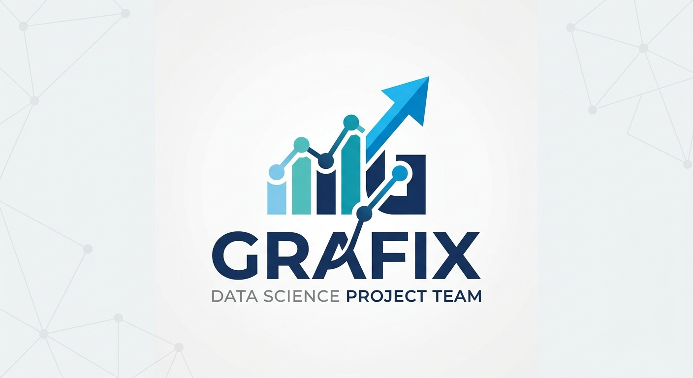

# FECAP - Fundação de Comércio Álvares Penteado

<p align="center">
<a href= "https://github.com/2026-2-NCC4/Projeto4"></a>
</p>

# Grafix

## Integrantes: <a href="https://github.com/Enzohenrique7">Enzo Henrique</a>, <a href="https://github.com/harryzuh">Harry Zhu</a>, <a href="https://github.com/Mura173">Murilo Ângelo</a>, <a href="https://github.com/vitorkolle">Vitor Kolle</a>

## Professores Orientadores: <a href="https://www.linkedin.com/in/eduardo-savino/">Eduardo Savino</a>, <a href="https://www.linkedin.com/in/luisspires/">Luis Pires</a>, <a href="https://www.linkedin.com/in/mauricio-lopes-42b8b33a3/">Mauricio Lopes</a>, <a href="https://www.linkedin.com/in/professorrodnil/">Rodnil da Silva</a>

## Descrição
O Grafix é uma plataforma de inteligência financeira criada para transformar grandes volumes de dados em informações claras, acessíveis e úteis para a tomada de decisão. Seu propósito é ajudar os gestores da CTI a entender melhor seu desempenho financeiro, acompanhando indicadores estratégicos em tempo real por meio de análises, relatórios e dashboards interativos publicados na nuvem.

A plataforma centraliza dados da fonte disponibilizada e realiza todo o processo de preparação das informações, desde a coleta e organização até a limpeza e integração dos dados. Dessa forma, garante maior confiabilidade nas análises e permite que as informações sejam utilizadas de forma segura, rastreável e organizada.

Além da visualização de indicadores financeiros como receita, custos, margem de lucro e ticket médio, o Grafix utiliza técnicas de estatística e ciência de dados para identificar tendências, padrões de comportamento e relações entre variáveis. Isso possibilita uma visão mais profunda do negócio, auxiliando no planejamento financeiro e na criação de estratégias mais assertivas.

Um dos principais diferenciais da solução é a capacidade de transformar dados complexos em insights fáceis de interpretar. Por meio de dashboards intuitivos, filtros dinâmicos e relatórios gerenciais, os usuários podem acompanhar a evolução dos resultados, comparar períodos e avaliar diferentes cenários de negócio, compreendendo o impacto de decisões relacionadas a custos, preços, descontos ou metas.

Mais do que uma ferramenta de análise, o Grafix busca atuar como um apoio estratégico para a gestão financeira, conectando tecnologia, dados e inteligência de negócio em uma única plataforma. O resultado é uma solução moderna, escalável e orientada a dados, capaz de transformar informações em conhecimento e conhecimento em decisões mais eficientes.

## Acesso ao Dashboard
https://grafix-dashboard-cti.streamlit.app/

## 📄 Entregas
| **Disciplina**              | **Entrega 1**                      | **Entrega 2**                        |
|-------------------------|--------------------------------|----------------------------------|
| **Análise Inferencial de Dados**          | [Relatório da análise descritiva dos dados](./Documentos/Entrega%201/Análise%20Inferencial%20de%20Dados/Relatório%20Entrega%201.pdf)     | [Relatório de Regressão dos Dados](./Documentos/Entrega%202/Análise%20Inferencial%20de%20Dados/Relatorio_Entrega.pdf) |
| **Contabilidade e Finançass**      | [Planilha CTI e Dicionário de KPIs](https://github.com/2026-2-NCC4/Projeto7/tree/f2a0d622b0f6efd93df7c3fc8dbffb6f8af1796b/Documentos/Entrega%201/Contabilidade%20e%20Finan%C3%A7as)       | [Painel Financeiro CTI](https://github.com/2026-2-NCC4/Projeto7/blob/c5714ad1dcdbe473d64483451eddd51ef4a67ea1/Documentos/Entrega%202/Contabilidade%20e%20Finan%C3%A7as/README.md) |
| **Engenharia de Software e Arquitetura de Sistemas**      | [ES E ML ](/Documentos/Entrega%201/Engenharia%20de%20Software%20e%20Arquitetura%20de%20Sistemas/ES%20E%20ML)    | [ES E ML](/Documentos/Entrega%201/Engenharia%20de%20Software%20e%20Arquitetura%20de%20Sistemas/ES%20E%20ML)     |
| **Projeto Interdisciplinar: Ciência de Dados**| [Dashboard - Google Colab e Documentos](https://github.com/Mura173/Projeto7/tree/main/Documentos/Entrega%201/Projeto%20Interdisciplinar%20Ci%C3%AAncia%20de%20Dados)                     | [Dashboard - Google Colab e Documentos](https://github.com/Mura173/Projeto7/tree/main/Documentos/Entrega%202/Projeto%20Interdisciplinar%20Ci%C3%AAncia%20de%20Dados)         |


</br>

## 🛠 Estrutura de pastas

```text
Projeto7
├── Documentos
│   ├── Entrega 1
│   │   ├── Análise Inferencial de Dados
│   │   ├── Contabilidade e Finanças
│   │   ├── Engenharia de Software e Arquitetura de Sistemas
│   │   └── Projeto Interdisciplinar Ciência de Dados
│   ├── Entrega 2
│   │   ├── Análise Inferencial de Dados
│   │   ├── Contabilidade e Finanças
│   │   ├── Engenharia de Software e Arquitetura de Sistemas
│   │   └── Projeto Interdisciplinar Ciência de Dados
│   └── README.md (declaração de uso de inteligência artificial)                      
├── Imagens
├── img
└── src
    ├── Entrega 1
    │   └── Projeto_Interdisciplinar_Ciência_de_Dados.ipynb  
    └── Entrega_2
        ├── Dashboard                  
        ├── Notebooks                  
        ├── Processing                 
        └── Staging
|README.md            
```


## 💻 Configuração para Desenvolvimento

### Entrega 1 (Google Colab)
Não é necessário instalar nada. Basta abrir o notebook em `src/Entrega 1` no Google Colab e fazer o upload da base de dados da CTI.

### Entrega 2 (dashboard em Streamlit)
O dashboard já está publicado em https://grafix-dashboard-cti.streamlit.app/. Para rodá-lo na sua máquina:

**Pré-requisitos**
* Python 3.11 ou superior (confira com `python --version`).
* Git
* Internet, apenas para baixar o repositório e instalar as bibliotecas

**1. Baixar o projeto**

```bash
git clone https://github.com/2026-2-NCC4/Projeto7.git
cd Projeto7
```

**2. Criar e ativar o ambiente virtual**

No macOS ou Linux:

```bash
python3 -m venv .venv
source .venv/bin/activate
```

No Windows (PowerShell):

```powershell
python -m venv .venv
.venv\Scripts\Activate.ps1
```

**3. Instalar as bibliotecas**

```bash
pip install -r src/Entrega_2/Dashboard/requirements.txt
```

**4. Abrir o dashboard**

```bash
streamlit run src/Entrega_2/Dashboard/app.py
```

O navegador abre em http://localhost:8501. Para encerrar, volte ao terminal e aperte `Ctrl+C`. Os dados já estão prontos na pasta `src/Entrega_2/Staging`, então não é preciso rodar os notebooks para ver o dashboard.

**Problemas comuns**

**Regenerar os dados**

Os arquivos de `Staging` foram gerados a partir da base original que está em `src/Entrega_2/Processing`. Para refazer o processo, instale o Jupyter no mesmo ambiente virtual e abra a pasta dos notebooks:

```bash
pip install notebook
jupyter notebook src/Entrega_2/Notebooks
```

Execute cada notebook um de cada vez, **nesta ordem**:

| Ordem | Notebook | Lê | Grava em `Staging` |
| :--- | :--- | :--- | :--- |
| 1 | `preparacao_dados.ipynb` | `Processing/Demonstrativo Fecap v3.csv` | `base_larga.parquet` |
| 2 | `kpis.ipynb` | `base_larga.parquet` | `kpis.parquet`, `kpi_catalogo.csv`, `percentis.csv` |
| 3 | `ranking.ipynb` | `kpis.parquet` | `top10_referencia.csv`, `top10_ranking.csv` |

Os notebooks usam caminhos relativos (`../Processing` e `../Staging`), por isso devem ser abertos a partir da pasta `Notebooks`, como no comando acima.

**Bibliotecas utilizadas**

| Bibliotecas | 
| :--- | 
| `streamlit` |
| `plotly` | 
| `pandas` | 
| `numpy` | 
| `pyarrow` | 

  
## 📋 Licença/License
<a href="https://github.com/2026-2-NCC4/Projeto7">Grafix</a> © 2026 by <a href="https://github.com/fecaphub">Enzo Henrique Neves Sena, Harry Zhu, Murilo Angelo Pimentel Braggio, Vitor Paes Kolle, FECAP</a> is licensed under <a href="https://creativecommons.org/licenses/by/4.0/">CC BY 4.0</a>


## 🎓 Referências

- <a href="https://plotly.com/python/">Plotly</a> </br>


